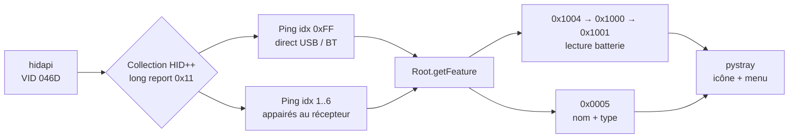

<div align="center">


# LogiBatt

**Le % de batterie de ta souris Logitech, en permanence dans la barre des tâches.**

Sans G HUB. Sans Logi Options+. Un seul `.exe` de 16 Mo.

[](https://github.com/BHAALOL/LogiBatt/releases/latest)
[](https://github.com/BHAALOL/LogiBatt/actions)


[](LICENSE)

</div>

---

## ✨ Fonctionnalités

- 🔋 **% de batterie affiché directement dans l'icône**, avec une couleur selon le niveau
- ⚡ **Indicateur de charge** quand la souris est branchée
- 🔔 **Notification Windows** quand la batterie passe sous 15 %
- 🖱️ **Multi-appareils** : la bulle et le menu listent tous les périphériques Logitech (souris, clavier…)
- 💤 **Souris en veille** : l'icône passe en gris et garde la dernière valeur connue
- 🤝 **Cohabite** avec G HUB / Logi Options+ si tu les as installés
- 🪶 **Léger** : un scan par minute, aucun service, aucune installation

| Icône | Signification |
|:---:|---|
| 🟩 | > 40 % |
| 🟧 | 16 – 40 % |
| 🟥 | ≤ 15 % (+ notification) |
| ⬜ | Hors ligne / en veille (dernière valeur connue) |
| ⚡ | En charge |

## 📥 Installation

1. Télécharge **`LogiBatt.exe`** depuis la [dernière release](https://github.com/BHAALOL/LogiBatt/releases/latest).
2. Lance-le. L'icône apparaît dans la zone de notification (éventuellement sous la flèche `^` : glisse-la dans la barre pour l'épingler).

> [!NOTE]
> L'exe n'est pas signé : Windows SmartScreen affichera *« Windows a protégé votre ordinateur »*.
> Clique sur **Informations complémentaires → Exécuter quand même**.

### Lancer au démarrage de Windows

`Win` + `R` → `shell:startup` → place un raccourci vers `LogiBatt.exe` dans ce dossier.

## 🖱️ Utilisation

| Action | Effet |
|---|---|
| Survol de l'icône | Nom et % de chaque appareil |
| Clic gauche | Rafraîchir immédiatement |
| Clic droit | Liste des appareils · Rafraîchir · Quitter |

## ✅ Compatibilité

LogiBatt parle **HID++ 2.0**, le protocole natif Logitech. Il fonctionne avec les connexions suivantes :

| Connexion | Support |
|---|:---:|
| Récepteur **Lightspeed** (gamme G) | ✅ |
| Récepteur **Bolt** | ✅ |
| Récepteur **Unifying** | ✅ |
| Câble USB | ✅ |
| Bluetooth | ✅ |

Méthodes de lecture de la batterie, essayées dans cet ordre :

| Feature HID++ | Modèles typiques | Précision |
|---|---|---|
| `0x1004` Unified Battery | MX Master 3/3S, MX Anywhere 3, Lift, Pro X Superlight 2… | % exact |
| `0x1000` Battery Status | Anciens modèles MX / M | % exact |
| `0x1001` Battery Voltage | G Pro Wireless, G502 Lightspeed, G703, G903… | % estimé (`~`) |

**Testé sur** : PRO X SUPERLIGHT 2 SE (Lightspeed).
Ta souris marche (ou pas) ? Ouvre une [issue](https://github.com/BHAALOL/LogiBatt/issues) pour compléter la liste.

## 🛠️ Depuis les sources

```powershell
git clone https://github.com/BHAALOL/LogiBatt.git
cd LogiBatt
pip install -r requirements.txt

python logibatt.py --once --debug   # diagnostic en console
pythonw logibatt.py                 # icône systray
```

### Compiler l'exe

```powershell
.\build.ps1        # -> dist\LogiBatt.exe
```

Chaque tag `v*` poussé déclenche aussi un build GitHub Actions sur `windows-latest`, qui publie l'exe dans une release.

### Paramètres

En tête de `logibatt.py` :

| Constante | Défaut | Rôle |
|---|---|---|
| `POLL_S` | `60` | Intervalle de rafraîchissement (s) |
| `LOW_THRESHOLD` | `15` | Seuil de notification batterie faible (%) |

## ⚙️ Comment ça marche



1. Énumère les interfaces HID Logitech (VID `0x046D`) et garde les collections HID++ *long report* (usage page `0xFF00` / `0xFF43` en BLE).
2. Ping chaque index : `0xFF` pour un appareil connecté en direct, `1` à `6` pour ceux appairés à un récepteur.
3. Interroge la feature *Root* pour trouver l'index des features batterie et nom, puis les lit.
4. Dessine l'icône avec Pillow et l'affiche via pystray. La souris est prioritaire ; les autres appareils apparaissent dans la bulle et le menu.

Les réponses sont filtrées par *software ID*, ce qui évite les collisions avec G HUB / Options+ qui écoutent sur la même interface.

## ❓ Dépannage

| Problème | Piste |
|---|---|
| Icône `?` grise | Aucun appareil trouvé. Bouge la souris pour la réveiller puis clic gauche sur l'icône. |
| Rien ne s'affiche | Lance `python logibatt.py --once --debug` et joins la sortie à une issue. |
| Alerte antivirus | Faux positif fréquent avec PyInstaller `--onefile`. Compile toi-même avec `build.ps1` si tu préfères. |

## 🙏 Crédits

- Protocole HID++ documenté grâce au travail de [Solaar](https://github.com/pwr-Solaar/Solaar) (table tension → %).
- [hidapi](https://github.com/trezor/cython-hidapi), [pystray](https://github.com/moses-palmer/pystray), [Pillow](https://python-pillow.org/).

Projet non affilié à Logitech.

## 📄 Licence

[MIT](LICENSE)
